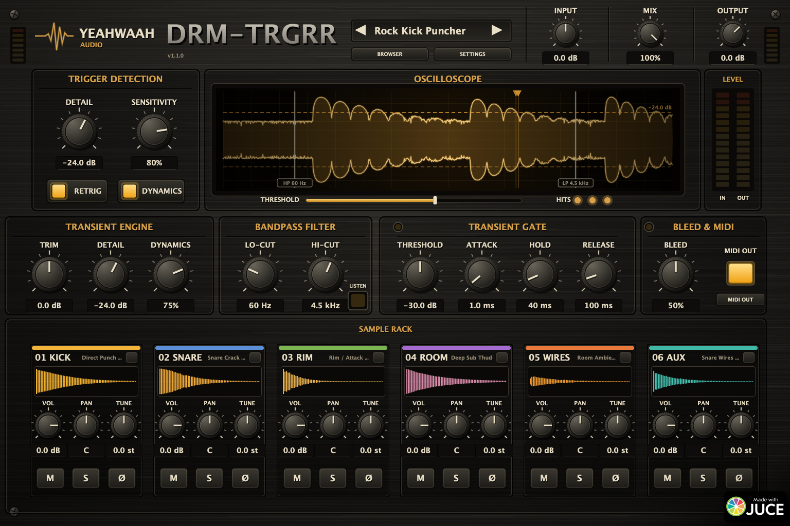
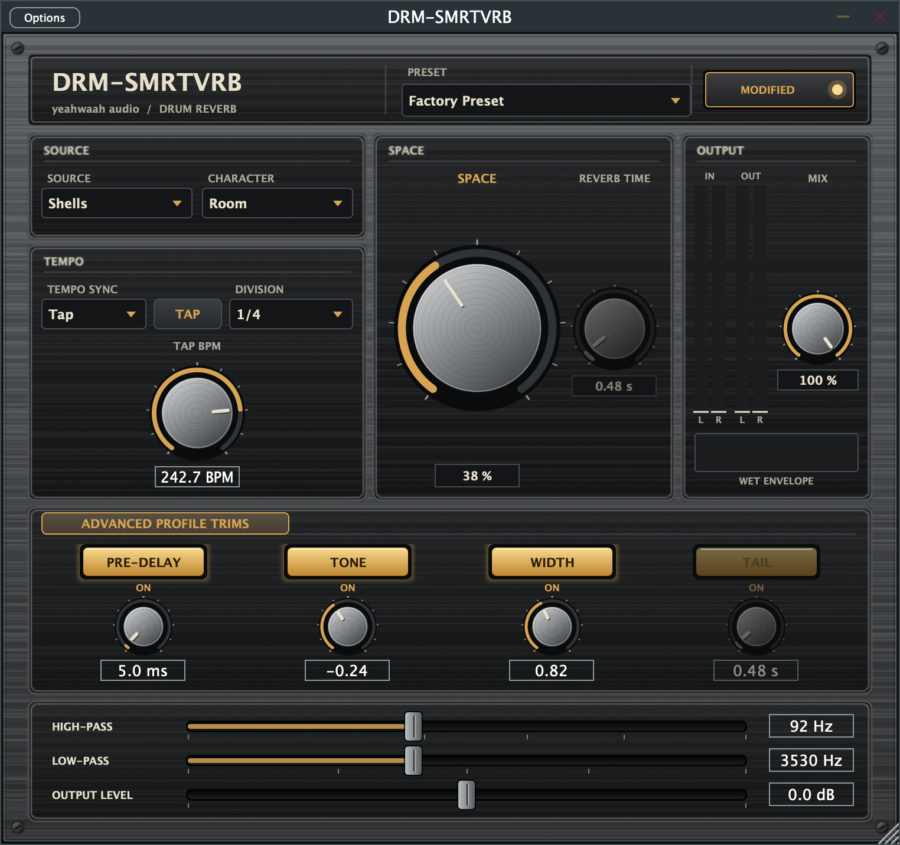
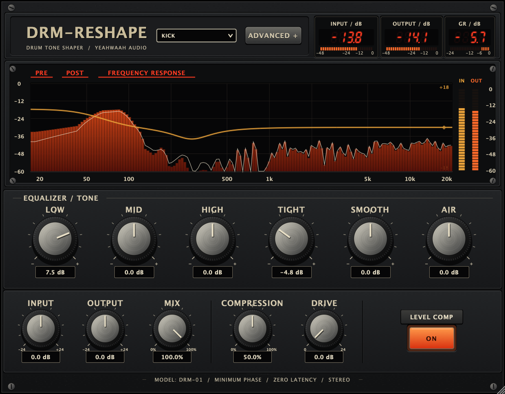

# DRM Series by yeahwaah audio

Drum-focused plugins. Download the latest build of each below.

> Windows (64-bit) builds. Copy the `.vst3` from the zip into `C:\Program Files\Common Files\VST3`.

---

## DRM-TRGRR

**Drum trigger and sample replacement.**

Detects drum hits in your recorded tracks and triggers or layers samples on top of them, so a weak kick or snare can be replaced or reinforced without losing the original performance.

**Highlights**

- Real-time scrolling scope with a draggable DETAIL threshold
- Band-pass detection filter with LISTEN audition
- Retrigger lockout, sensitivity and dynamics for clean, reliable triggering
- Bleed suppression and a transient gate for spill-heavy multi-mic sessions
- Six sample slots with volume, pan, tune, solo, mute and phase flip
- Per-slot envelopes and velocity range, built-in factory drum sounds, drag-and-drop WAV/AIFF loading
- MIDI in and out for triggering and for driving other instruments

**Latest: v1.1.0** (released 2026-11-25)

| Download | Size |
| --- | --- |
| [DRM-TRGRR.1.1.0-Win64.zip](https://github.com/elvicw89/DRM-Plugins/raw/main/downloads/DRM-TRGRR/DRM-TRGRR.1.1.0-Win64.zip) | 4.3 MB |

---

## DRM-SMRTVRB

**Drum reverb with a one-knob workflow.**

A reverb built for drums. Pick the drum source, pick a reverb character, and shape the result with a single SPACE control instead of tuning a generic reverb from scratch.

**Highlights**

- Source profiles for Shells, Snare, Room and Overheads
- Three engines: Room, Spring and Gated
- SPACE macro tuned separately for each of the twelve source/engine combinations
- Tempo sync, free timing and tap tempo
- HPF and LPF on the reverb return, advanced overrides and factory presets

**Latest: v0.4.0** (released 2026-11-24)

| Download | Size |
| --- | --- |
| [DRM-SMRTVRB-0.4.0-Windows-VST3.zip](https://github.com/elvicw89/DRM-Plugins/raw/main/downloads/DRM-SMRTVRB/DRM-SMRTVRB-0.4.0-Windows-VST3.zip) | 2.3 MB |

---

## DRM-RESHAPE

**Drum-focused equalizer and tone shaper.**

An equalizer that starts from the instrument you are mixing. Choose what you are working on and get a sensible starting curve, then fine-tune every band by ear.

**Highlights**

- Instrument starting points for Kick, Snare, Toms, Overheads, Room, Full Kit and Hi-Hats
- Six editable bands with a live pre/post spectrum display
- TIGHT and SMOOTH dynamic bands that cut only when a frequency gets too loud
- Compression macro and Drive saturation after the EQ
- Wet/dry, output control and input, output and gain-reduction meters

**Latest: v1.4.0** (released 2026-11-24)

| Download | Size |
| --- | --- |
| [DRM-RESHAPE-Windows-x64.zip](https://github.com/elvicw89/DRM-Plugins/raw/main/downloads/DRM-RESHAPE/DRM-RESHAPE-Windows-x64.zip) | 5.4 MB |

---
